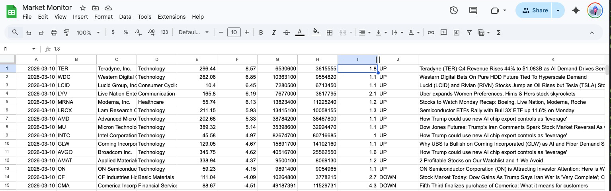
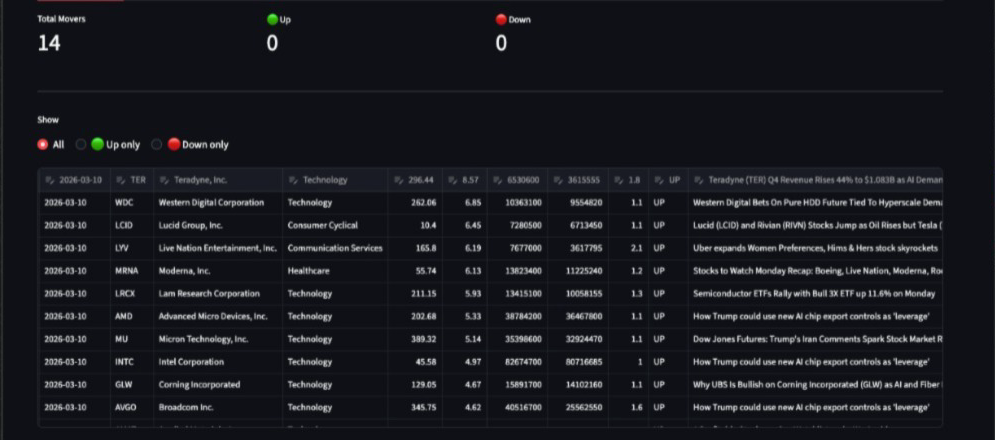

# market-monitor

Automated after-hours and pre-market stock scanner with a Streamlit dashboard.

Scans the market for unusual price moves and volume spikes across end-of-day, evening, and pre-market sessions, logs results to Google Sheets, and displays them in an interactive dashboard with watchlist functionality.

See [OVERVIEW.md](OVERVIEW.md) for full documentation, [CHANGELOG.md](CHANGELOG.md) for development history, and [ROADMAP.md](ROADMAP.md) for future plans.

## Screenshots

**Scan results logged to Google Sheets:**

**Dashboard view:**

